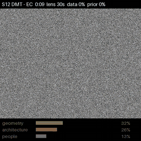
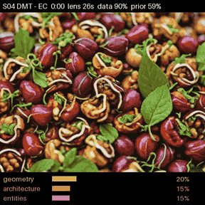
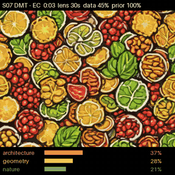
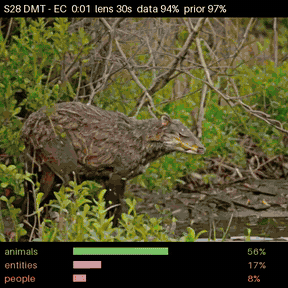
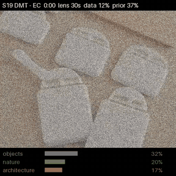
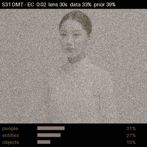

# DMT EEG Visual Reconstruction

N,N-DMT is widely regarded as the psychedelic with the most vivid and characteristic visuals: dense geometric patterns, impossible architecture, encounters with beings, all within a few minutes and with eyes closed. People describe them in strikingly similar terms, yet the experience leaves no trace anyone else can look at.

This project asks whether scalp EEG can translate part of that subjective visual experience into images, even partially. It takes EEG recorded while participants were under DMT, decodes it with models trained on sober people viewing images (THINGS-EEG2), and renders the result over time with a diffusion generator. Each video below is one participant's DMT session minus their own eyes-closed rest.

> **This is an exploratory project, not academic research.** It was built out of curiosity, without the rigor of a scientific study: no pre-registered hypotheses, no peer review, and no claim of statistical validity. The results are a first look at what is possible, meant to be explored, questioned and improved.

**[See all cases and videos](docs/cases/README.md)** · **[See all results](docs/results.md)**

<table>
  <tr>
    <td align="center" width="33%"><br><b>S12</b><br>reported patterns 90 · scenes 73<br><a href="docs/cases/S12_dmt_minus_rest.mp4?raw=true">download video (mp4)</a></td>
    <td align="center" width="33%"><br><b>S04</b><br>reported patterns 85 · scenes 72<br><a href="docs/cases/S04_dmt_minus_rest.mp4?raw=true">download video (mp4)</a></td>
    <td align="center" width="33%"><br><b>S07</b><br>reported patterns 83 · scenes 33<br><a href="docs/cases/S07_dmt_minus_rest.mp4?raw=true">download video (mp4)</a></td>
  </tr>
  <tr>
    <td align="center" width="33%"><br><b>S28</b><br>reported patterns 81 · scenes 59<br><a href="docs/cases/S28_dmt_minus_rest.mp4?raw=true">download video (mp4)</a></td>
    <td align="center" width="33%"><br><b>S19</b><br>reported patterns 87 · scenes 48<br><a href="docs/cases/S19_dmt_minus_rest.mp4?raw=true">download video (mp4)</a></td>
    <td align="center" width="33%"><br><b>S31</b><br>reported patterns 84 · scenes 57<br><a href="docs/cases/S31_dmt_minus_rest.mp4?raw=true">download video (mp4)</a></td>
  </tr>
</table>

Under each video: what that participant reported seeing during the session, on a 0-100 questionnaire scale (5D-ASC). *Patterns* is simple imagery such as colors, shapes and geometric patterns; *scenes* is complex imagery such as scenes, beings and objects. These six are among the strongest experiences in the dataset.

## How to read a video

Each frame has three parts:

- **The picture.** An AI image generator draws what the brain signal of that moment most resembles. The picture changes only when the signal changes.
- **Top strip.** The time within the session, how many seconds of EEG were averaged for this frame (`lens`), and two confidence scores from 0 to 100% (`data` and `prior`, explained below).
- **Bottom strip.** The three kinds of image the signal leans toward at that moment, out of seven: geometry, architecture, entities, people, animals, nature, objects.

When the picture dissolves into **static**, the signal at that moment is too weak or too inconsistent to support any picture.

The kind of image (the category) is read from the EEG. The specific picture is the generator's illustration of that category, not a recording of what the person saw.

## How it works

EEG is the electrical activity of the brain measured by electrodes on the scalp. The pipeline turns it into video in five steps.

1. **Translate EEG into "image descriptions".** A decoder is a model that learns the link between brain signals and images. Ours was trained on a public dataset (THINGS-EEG2) in which sober volunteers looked at thousands of photos while their EEG was recorded. Given one second of EEG, it outputs a list of numbers that describes an image, in the same numeric format that AI image models use internally.
2. **Remove what is not about the moment.** Two things are subtracted: what the decoder outputs for a scrambled copy of the same recording (which keeps the rhythms of the signal but destroys their timing), and the participant's own resting recording with eyes closed and no drug. What remains is what the DMT session adds.
3. **Choose how much signal to average.** One second of EEG is far too noisy on its own. For every moment, the pipeline works out the shortest stretch of signal whose average can be trusted, up to 30 seconds. This is the `lens`.
4. **Score the confidence.** The session's data is split into two independent halves; if both halves point to the same image description, the frame is trusted (`data`). Where the local data is weak, the pipeline falls back on what that participant's signal usually looks like at that level of drug effect (`prior`). If neither holds, the frame turns to static.
5. **Draw.** The image description goes to an image generator (SDXL-Turbo), with no text prompt and no memory of the previous frame.

The drug effect over time is measured from the EEG itself: DMT suppresses the brain's alpha rhythm, and the amount of suppression is used as a gauge of how strong the effect is at each moment.

Everything runs on a laptop (Apple M4 Pro, about 2 seconds per frame).

## What we found so far

The data comes from a public study in which 35 people inhaled DMT while wearing an EEG cap, and afterwards rated their experience on a standard questionnaire.

- **The videos are not random.** When a session's data is split into two independent halves and a video is built from each, the two tell the same story over time. The way the signal shifts as the drug effect rises and falls is also similar from person to person.
- **Most sessions follow a common path.** In about 20 of 25 participants, the readout leans toward living things (people, animals, entities) when the drug effect is strongest and toward geometry and architecture as it fades.
- **People who reported more geometric patterns tend to produce more geometric videos.** Across 25 participants the correlation is 0.38 (p = 0.06): suggestive, not yet conclusive. One participant (S07) reported strong patterns and almost no scenes or beings, and their video is almost entirely geometric.
- **A decoder trained on some people works on a new person**, as long as the recordings come from the same lab and equipment.
- **A trustworthy picture needs about 30 seconds of EEG.** A 9-minute session supports on the order of ten distinct scenes.
- **Sessions lost to a single faulty electrode can be recovered**, bringing back several of the participants with the strongest experiences.

## What it does not do yet

- **It does not show what the person saw.** The decoder learned from photos of everyday objects, on different equipment. It can say "this moment looks more like dense patterns than like a living thing", not "this is the entity they met".
- **Rest also produces pictures.** A sober brain with eyes closed gives pattern-like videos too. The meaningful quantities are the difference from rest and the differences between people.
- **The category balance is sensitive to processing choices**, such as how a faulty electrode is handled. Some participants' profiles are stable under such changes (S07, S12), others are not.

The next step is calibration on the same equipment: record sober volunteers viewing images, including geometric and visionary imagery, at unpredictable moments, then decode DMT sessions with a model trained on that. The design is in the [experiment log](docs/experiment-log.md).

## Documentation

- [Cases](docs/cases/README.md): the six videos, per participant
- [Glossary](docs/glossary.md): every term and abbreviation used in the docs
- [Results](docs/results.md): all numbers and control experiments
- [Experiment log](docs/experiment-log.md): everything that was tried, in order, including what failed
- [References](docs/references.md): papers, datasets and model repositories
- [Original brief](docs/brief.md)

The sections below are for running the code.

## Quick start: make a video

Needs Python 3.11, about 20 GB of disk and either an Apple-silicon Mac or an NVIDIA GPU. Nothing has to be trained: the decoder used for the published videos is downloaded ready to use.

```
git clone https://github.com/bruno-berchielli/dmt-eeg-visual-reconstruction.git
cd dmt-eeg-visual-reconstruction
python3.11 -m venv .venv && source .venv/bin/activate
pip install -r requirements.txt

cd src
python download_data.py videos                 # decoder (2 MB) + DMT recordings (1.5 GB, about 10 min)
python onset_cache.py dmt                      # filter and resample the recordings
python drug_curve.py                           # strength of the drug effect over time
python dmt_dense.py                            # decode every recording (about 2 min)
python dmt_events_video.py S07 T500multi DMT inferred contrast step=1 target=0.65 max=30
```

The video is written to `outputs/videos/`. The first run of the last command also downloads the image generator (10 to 17 GB). Replace `S07` with any participant from `S01` to `S35`; add `tmax=60` to render only the first minute, or `name=myvideo` to choose the file name. On an Apple M4 Pro each frame takes about 2 s, so a full session takes 10 to 20 minutes.

To retrain the decoder instead of downloading it (52 GB of THINGS-EEG2, about 12 GB more for caches):

```
python download_data.py training
python things_multi.py 08 01 02 03 05
```

## Models and generator

| Component | Source |
|---|---|
| ATM (EEG encoder, reimplemented as ATM-S with channel subsets) | [ncclab-sustech/EEG_Image_decode](https://github.com/ncclab-sustech/EEG_Image_decode), [arXiv 2403.07721](https://arxiv.org/abs/2403.07721) |
| Image embedding space | [OpenCLIP ViT-H/14 LAION-2B](https://huggingface.co/laion/CLIP-ViT-H-14-laion2B-s32B-b79K) |
| Generator | [SDXL-Turbo](https://huggingface.co/stabilityai/sdxl-turbo), 4 steps, 512 px, no text prompt |
| Conditioning | [IP-Adapter](https://huggingface.co/h94/IP-Adapter) `ip-adapter_sdxl_vit-h` |

## Data

| Dataset | Content | Path |
|---|---|---|
| [Zenodo 3992359](https://zenodo.org/records/3992359) | inhaled DMT, 35 participants, 24 channels, 500 Hz, DMT / eyes closed / eyes open, 5D-ASC | `data/raw/dmt/` |
| [OSF wujgp](https://osf.io/wujgp/) | intravenous DMT vs placebo, 12 participants, 6 midline electrodes | `data/raw/osf_waves/` |
| [OpenNeuro ds006110](https://openneuro.org/datasets/ds006110) (PsiConnect) | psilocybin vs baseline, 64 channels, cloud movie | `data/raw/psiconnect/` |
| [Figshare 30227503](https://doi.org/10.6084/m9.figshare.30227503) | perception and imagery of 10 images, 22 participants, 32 channels | `data/raw/imagery/` |
| [HF LidongYang/EEG_Image_decode](https://huggingface.co/datasets/LidongYang/EEG_Image_decode) | THINGS-EEG2 preprocessed at 250 Hz (sub-01, 02, 03, 05, 08), CLIP features, images | `data/raw/things/` |

Only the first and the last are needed for the videos, and `download_data.py` fetches both (see Quick start). The other three were used in the control experiments and have to be downloaded by hand into the paths above.

Data, trained models and outputs are not versioned. The trained decoder is attached to the [`decoder-v1` release](https://github.com/bruno-berchielli/dmt-eeg-visual-reconstruction/releases/tag/decoder-v1). Reports are copied to `docs/reports/`.

## Setup

```
python3.11 -m venv .venv && source .venv/bin/activate
pip install -r requirements.txt
```

`requirements.lock.txt` lists the exact versions the published videos were generated with. Tested on an Apple M4 Pro (48 GB) with MPS: about 2 s per generated frame. A CUDA GPU is selected automatically when present but has not been tested.

## Training

Run from `src/`. All decoders map EEG windows (250 Hz, 1 s, average reference, per-channel z-score) to CLIP ViT-H/14 image embeddings of the THINGS images.

| Model | Script | Notes |
|---|---|---|
| ATM-S encoder, one subject, any channel subset | `train_encoder.py --channels … --tag …` | contrastive + MSE, as in the ATM repo; retrained because published weights need 63 channels |
| Linear baseline | `train_linear.py` | ridge on the waveform |
| Jitter-tolerant event decoder | `event_decoders.py` | centered ridge, 20 ms bins from 100 to 540 ms, copies shifted ±40 ms |
| Five-subject decoder and onset template (used by the videos) | `things_multi.py 08 01 02 03 05` | ridge from per-subject sufficient statistics; matched-filter template on 14 channels; add `gate` to also run the cross-lab check on the imagery dataset |
| Single-image lab model | `vi_model.py` | detector and decoder trained on the 10-image dataset |

## Pipeline

| Stage | Scripts |
|---|---|
| Preprocess | `preprocess_dmt.py`, `preprocess_osf.py`, `preprocess_psiconnect.py`, `preprocess_imagery.py`, `onset_cache.py`, `cache_things.py` |
| First-phase decoding and contrasts | `embed_dmt.py`, `analyze_contrasts.py`, `render.py`, `analyze_osf.py` |
| Bias and specificity controls | `test_spectral_transplant.py`, `test_specificity.py`, `test_text_probes.py`, `cloud_control.py`, `analyze_imagery.py`, `test_imagery_waveform.py`, `gate_perception.py` |
| Weight reading and gradient-free edits | `read_weights.py`, `weight_surgery.py`, `model_variants.py` |
| Time dependence (abandoned shift-invariant path) | `test_shift_invariance.py`, `shift_features.py`, `train_shift_robust.py`, `shift_invariance_table.py` |
| Window, low-level target, tolerance | `window_sweep.py`, `lowlevel.py`, `tolerance_test.py` |
| Onset detection and cross-lab checks | `onset_lib.py`, `onset_things.py`, `onset_imagery.py`, `detector_check.py`, `lag_curve.py`, `loso_imagery.py` |
| Event decoding on DMT | `dmt_events.py`, `dmt_events_render.py`, `dmt_events_vi.py`, `dmt_events_vi_render.py`, `dmt_events_one.py`, `dmt_chain.py` |
| Dense decoding, reliability, lens | `dmt_dense.py`, `halves_group.py`, `lens_model.py` |
| Drug level, direction, stages | `drug_curve.py`, `drug_direction.py`, `pattern_score.py`, `stage_kinetics.py` |
| Videos | `dmt_events_video.py`, `categories.py`, `repair_recording.py` |
| Phenomenology prediction | `pheno_features.py`, `pheno_predict.py`, `analyze_psiconnect.py` |

Shared modules: `common.py` (channels, normalization, architecture), `decode.py` (embedding, concept space, consistency tests), `sdxl.py` (generator).

The commands for the final videos are in [Quick start](#quick-start-make-a-video).

## Layout

```
src/            scripts (download_data.py fetches data and the decoder)
docs/           brief, experiment log, results, references, reports, figures, cases
data/ models/ outputs/ external/    not versioned
```

## License and attribution

- Code: [MIT](LICENSE).
- Documentation, figures, videos and GIFs: [CC BY 4.0](LICENSE-docs).
- The EEG behind the videos comes from Pallavicini et al. (2021), [Zenodo 3992359](https://doi.org/10.5281/zenodo.3992359), CC BY 4.0. The pictures were generated with SDXL-Turbo (Powered by Stability AI).

Datasets and model weights are not redistributed and keep their own licenses. Full credits and terms: [NOTICE.md](NOTICE.md).
