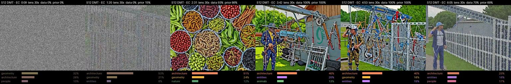
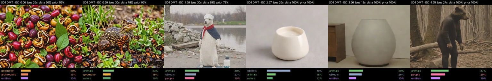
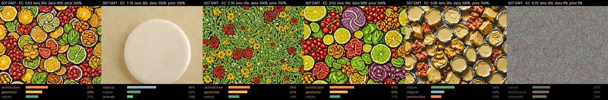
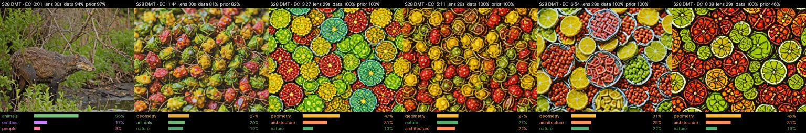
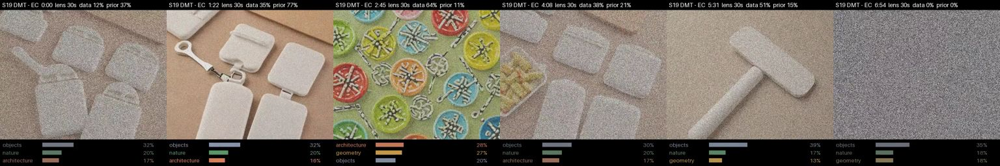
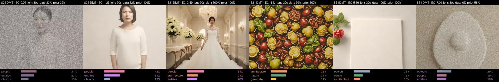

# Cases

Six participants of the inhaled-DMT dataset (Zenodo 3992359) with the strongest experiences (5D-ASC total) among those whose recordings needed no electrode repair. Each video is the DMT recording minus the same participant's sober eyes-closed recording.

Settings: dense template-aligned windows, five-subject THINGS ridge decoder, phase-randomized surrogate mean subtracted, inferred lens capped at 30 s (target reliability 0.65), confidence calibrated against other participants, one frame per second of recording played at 12 fps.

```
cd src && python dmt_events_video.py S07 T500multi DMT inferred contrast step=1 target=0.65 max=30
```

## How to read a frame

- **Top strip:** time in the recording, lens width in use, confidence in the local data, confidence in the state prediction (a regression of the participant's own vectors on the measured alpha suppression).
- **Image:** generated from the frame vector with a fixed seed and no image prior. It is blended with static in proportion to the lower confidence; static means neither the data nor the prediction hold.
- **Bottom strip:** the three categories the vector leans to, with relative weights over seven text-probe categories (geometry, architecture, entities, people, animals, nature, objects). Weights are relative, not probabilities.
- The category is what the data support. The concrete picture is an illustration by the generator.

## Videos

Structure = geometry + architecture; beings = entities + people + animals (mean weight over the recording). Elementary / complex imagery are 5D-ASC subscales (group medians 85 / 53).

| Participant | 5D-ASC total | Elementary / complex imagery | Structure / beings | Leading category by third | Frames visible (confidence > 0.75) | Video |
|---|---|---|---|---|---|---|
| S12 | 1317 | 90 / 73 | 0.60 / 0.27 | geometry, architecture, architecture | 70% (23% static) | [download](S12_dmt_minus_rest.mp4?raw=true) |
| S04 | 1214 | 85 / 72 | 0.15 / 0.54 | geometry, objects, animals | 89% | [download](S04_dmt_minus_rest.mp4?raw=true) |
| S07 | 1168 | 83 / 33 | 0.45 / 0.11 | objects, architecture, nature | 89% | [download](S07_dmt_minus_rest.mp4?raw=true) |
| S28 | 1158 | 81 / 59 | 0.53 / 0.21 | animals, geometry, geometry | 100% | [download](S28_dmt_minus_rest.mp4?raw=true) |
| S19 | 1010 | 87 / 48 | 0.32 / 0.23 | objects, architecture, objects | 18% (25% static) | [download](S19_dmt_minus_rest.mp4?raw=true) |
| S31 | 968 | 84 / 57 | 0.25 / 0.44 | people, architecture, objects | 90% | [download](S31_dmt_minus_rest.mp4?raw=true) |

| | |
|---|---|
| S12 |  |
| S04 |  |
| S07 |  |
| S28 |  |
| S19 |  |
| S31 |  |

## What the cases show

- **S07** reported strong patterns and few scenes or beings; the video is almost entirely structure (beings 0.11, among the lowest of 30 participants).
- **S12, S28** reported both; both poles appear, in opposite order.
- **S04** opens with patterns and moves to objects and beings.

## Scope

The decoder was trained in another lab, so the videos read the brain state as it evolves, in image categories, rather than specific content. The category is what the data support; the concrete picture is the generator's illustration. Sessions have no time-resolved report, so the order of scenes cannot be checked against experience.
